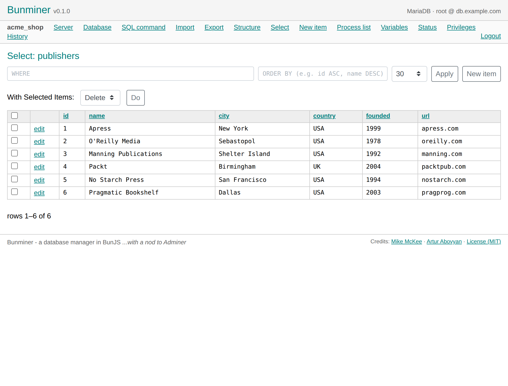

# Bunminer

A fast, modern, self-hosted **database manager** for **MariaDB/MySQL**, **PostgreSQL**, and
**SQLite** — built on [Bun](https://bun.sh), with a nod to [Adminer](https://www.adminer.org/).

Bunminer is the "as close and easy as Adminer" tool for the Bun/Node ecosystem: browse, query,
import/export, and administer your databases from a clean web UI — **with zero PHP**.



## What it can do

- Browse **databases, tables, columns, indexes, and foreign keys**.
- Run **arbitrary SQL** with a sortable, paginated results grid and export.
- **Create / edit / drop** tables, columns, indexes, views, sequences, functions, and types.
- **Import / export** SQL (with gzip) and download individual BLOB cells.
- **User & privilege management** (MariaDB/PostgreSQL).
- Server **status, variables, and process list**.
- Multi-engine: **MariaDB/MySQL, PostgreSQL, SQLite**.

## Why Bunminer?

- **No PHP** — runs entirely on Bun (no PHP-FPM, no Apache).
- **No passwords in the repo or on disk** — database credentials are entered at login and
  held in server memory only.
- **Security-first** — parameterized SQL, CSRF protection, per-install signed sessions,
  rate-limited login, and hardened-by-default settings (see `FORTIFICATION.md`).

## Requirements

- [Bun](https://bun.sh) 1.x
- **systemd** (Linux) to run it as a service
- **nginx** (or any reverse proxy) for TLS termination
- One or more database servers to manage (optional — it's a client)

## Install

```bash
git clone https://github.com/volomike/bunminer.git
cd bunminer
bun install
```

Then edit `config/config.js` to list the database servers you manage, and set up a systemd
service + nginx reverse proxy. **Full step-by-step instructions — including the systemd unit,
nginx vhost, TLS, and security hardening — are in [INSTALL.md](INSTALL.md).**

Quick local run (for development):

```bash
bun run server.js
# → http://127.0.0.1:3070  (port comes from the PORT env var; defaults to 3070)
```

## Security

Bunminer is a **high-power tool**: one successful login can read, write, or destroy a database.
Read **[INSTALL.md](INSTALL.md)** and **[FORTIFICATION.md](FORTIFICATION.md)** before exposing
it to the internet. There is intentionally **no built-in two-factor authentication** — it
authenticates using your database passwords. Report security issues privately — see
**[SECURITY.md](SECURITY.md)**.

## License

[MIT](LICENSE) © 2026 Mike McKee and Artur Abovyan.

- Mike McKee — <https://github.com/volomike>
- Artur Abovyan — <https://github.com/ArturAbovyan>
